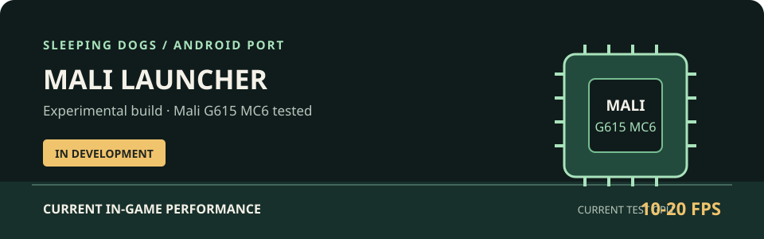
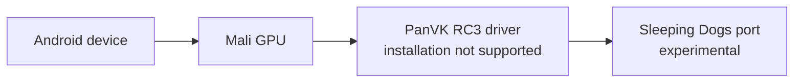

# Sleeping Dogs Android Port Launcher for Mali GPUs

An Android launcher project for the Sleeping Dogs port, with a focus on Mali GPU
devices.

## Status

This project is currently experimental and under active development. It is not
yet a polished or stable experience. In current testing, in-game performance is
approximately 10–20 FPS, and visual quality is not yet satisfactory. Performance
and visuals are still being worked on.

## Test Hardware

- GPU tested: Mali G615 MC6

Results may vary across devices and configurations. The Mali G615 MC6 is the
currently reported test GPU; compatibility and performance on other Mali GPUs
have not been established here.

## PanVK RC3 Driver

PanVK RC3 is noted as a driver attachment for Mali devices. Driver installation
is not supported by the launcher yet. There is no driver package in this
repository checkout, so check the project's release or attachment source for
the package and its requirements.

## Current Flow

## Contributing

Interested in improving performance or visuals? Fork this repository and work
on an optimized version of the Mali GPU launcher. Contributions and test results
from other Mali devices are welcome.

## Images

The graphic at the top is a project status illustration, not a gameplay
screenshot. Gameplay images are not included yet.

## Notes

Expect bugs, low frame rates, and incomplete visuals while development
continues. This README will be updated as testing and project status change.
